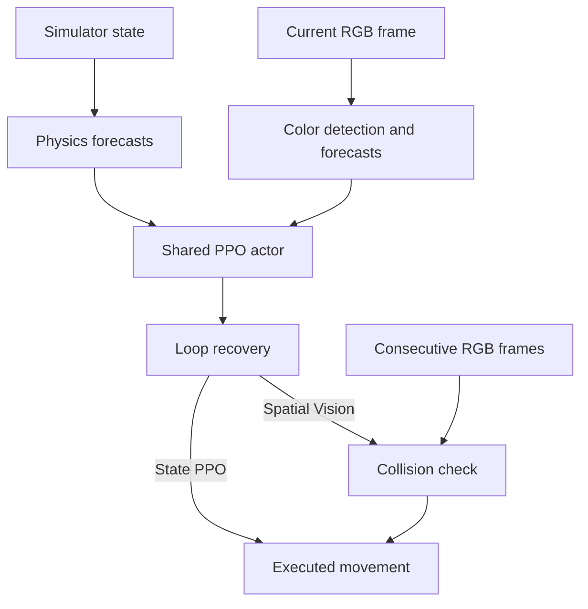

# How Phantom Escape works

Phantom Escape generates a maze from a run seed and level number. The player collects enough coins to unlock the exit, avoids moving phantoms, and reaches the exit before the timer expires. All three AI modes play through the same simulation as Human mode.

**Spatial Vision in the arcade uses color-based object detection and a PPO-trained movement policy.** The browser turns an RGB frame into movement features and runs a dense neural network. The experimental Python trainer can also give PPO a CNN feature vector. The selected checkpoint had a zero CNN contribution, so the exported browser model contains the dense policy alone.

## Game loop and rules

The [engine](../src/demos/phantom-escape/engine.ts) owns the maze, timer, score, player, coins and phantoms. A board has **40 × 24 tiles**, each **16 × 16 game pixels**, for a **640 × 384** playfield. Actors have continuous pixel coordinates even though pathfinding works with tiles.

- Physics runs at **60 ticks per second**. The player moves at 96 game pixels per second on clear floor. Diagonal movement is normalized so it covers the same total distance as cardinal movement.
- The engine checks the player's four corners against the floor grid and resolves horizontal and vertical movement separately. This lets the player slide along walls while blocking cuts through closed corners.
- Each tick checks the timer, moves the player and enemies, checks captures, then checks pickups and the exit. A phantom within 10 game pixels of the player ends the run. Coin pickup and exit entry require the player to be in the target tile and within 8 pixels of its center.
- Coins award **100 points** each. Collecting at least **60%**, rounded up, opens the exit. Using it awards **500 points** and advances the level. Collecting every coin adds a **200-point** bonus at the exit.
- The next level gets a new board and timer from the same run seed. The score carries across levels. Coins and enemies are placed at level creation.

The [arcade component](../src/demos/phantom-escape/PhantomEscape.tsx) handles Human input, pause and resume, sound effects, mode switching and the HUD. [The game renderer](../src/demos/phantom-escape/render.ts) paints the visible maze and masked player sprite. **Retry Maze** resets to level 1 with the same seed. **New Maze** picks a random seed. **Load Seed** accepts a whole number from 0 through 4,294,967,295 and prepares level 1 for the next Start Run.

## Map generation and placement

[The generator](../src/demos/phantom-escape/map.ts) uses a deterministic pseudorandom stream initialized from the seed and level. It chooses the map family separately from the stream used for carving and placement. During levels 1–3, the two early families alternate, with the seed deciding which one comes first. Starting at levels 4 and 7, the generator selects from an expanded pool, so a newly eligible family can appear from its unlock level onward.

| Family | Eligible from | How the floor is built |
| --- | ---: | --- |
| Open arena | 1 | Opens the interior, then places rectangular obstacles in spaced slots. Continuous lanes run around the obstacles. The player starts at one of four interior corners. |
| Room dungeon | 1 | Places rooms on a 4 × 3 grid, varies their size and offset, and connects them with L-shaped corridors. Each room connects to an earlier room. Optional links create loops. |
| Hybrid dungeon | 4 | Uses the room generator with larger chambers and narrow connecting corridors. |
| Labyrinth | 7 | Uses randomized depth-first carving from an odd-coordinate tile, then opens some links to create alternative routes. |

After carving, [breadth-first search](../src/demos/phantom-escape/map.ts) measures walking distance from the player's spawn over cardinal floor neighbors. The exit occupies a farthest reachable tile. The generator shuffles the other reachable tiles, places enemies at least 12 walking tiles from the spawn, then assigns coins to unused tiles. The spawn, exit, enemies and coins all occupy distinct tiles at the start. The outer border stays solid.

| Setting | Level 1 | Growth | Cap |
| --- | ---: | --- | ---: |
| Coins | 20 | Two more per level | 40 |
| Enemies | 2 | One more every two levels | 8 |
| Time | 60 seconds | Five more seconds per level | 90 seconds |
| Enemy speed | 55% of player speed | Five percentage points per level | 90% |

## Enemy movement

Both implemented enemy types appear at level 1. The [engine](../src/demos/phantom-escape/engine.ts) assigns Patrollers to even spawn indices and Chasers to odd indices. They move along cardinal floor tiles, committing to the next tile center before deciding again.

| Enemy | Behavior |
| --- | --- |
| **Patroller** (purple) | Chooses its next neighboring tile deterministically from its current cell and spawn index. It avoids immediately reversing when another connection exists. Layout and traversal history shape its route. |
| **Chaser** (pink) | At a tile center, checks whether the player is within seven walking tiles. If there is a path whose distance can be reduced, it takes a step along a shortest route. Outside pursuit it uses the same deterministic movement rule as the Patroller. Entering pursuit can trigger an alert. |

Dasher and Interceptor are planned enemy types. The current simulation implements Patroller and Chaser.

## Which AI sees what

| Mode | Observation | Decision maker | How it was built |
| --- | --- | --- | --- |
| Tactical A* | Exact maze and simulator state | Risk-weighted route search and physics lookahead | Hand-written planning rules |
| State PPO | Numerical forecasts from exact simulator state, plus HUD | Dense PPO policy with temporary route recovery | Imitation learning followed by reinforcement learning |
| Spatial Vision | Simplified RGB frames and HUD | The same dense PPO policy, with route recovery and a frame-based collision check | State PPO policy transferred to pixel-derived inputs |

The collision check applies in Spatial Vision. Both learned modes update their decision at **10 Hz** and hold it for **six physics ticks**. Each has nine action IDs in [observations.ts](../src/demos/phantom-escape/observations.ts), from 0 through 8 in this order: Wait, Up, Up-right, Right, Down-right, Down, Down-left, Left and Up-left.

## Tactical A Star

[Tactical A*](../src/demos/phantom-escape/tactics.ts) is the default Phantom Escape AI. It treats navigation and immediate collision avoidance as two jobs.

1. **Choose a goal.** While the exit is locked, rank nearby coins and run A* for a small set of candidates. Reusing the previous goal is slightly favored during normal progress. Once the quota is met, plan toward the exit.
2. **Find a route.** [A*](../src/demos/phantom-escape/path.ts) searches cardinal floor neighbors with Manhattan distance as its heuristic. Travel costs increase near each enemy's present tile and the next tile it is already moving toward. Nearby threats are measured along floor routes. A route can take a longer path to avoid danger.
3. **Follow the route and check danger.** The controller steers toward the next tile center, aligning with tight corridors before turning. Routes normally refresh every 12 physics ticks. Evasion checks run every six ticks and simulate up to 18 ticks of movement. If the route comes too close to an enemy, the controller scores alternate inputs on clearance, collision and route progress.
4. **Regroup when stuck.** The planner tracks visits and progress. After sustained repetition, it can follow a short route to a less-visited tile before resuming its goal. Local evasion can still interrupt regrouping.

**Show AI Plan** draws the route, explored tiles and danger on the playable maze. The inspector can report Collect, Escape, Regroup or Evade.

## State PPO

### What the actor receives

[The forecast code](../src/demos/phantom-escape/forecast.ts) copies the player and enemies and projects every candidate move for up to six ticks. It also computes shortest walking distances from the remaining coins and exit so the features account for walls. The forecast leaves the live board untouched.

| Input block | Values | Content |
| --- | ---: | --- |
| Candidate moves | 99 | Eleven values for each of nine actions. The values describe direction, projected X and Y movement, movement magnitude, gains toward a coin and the exit, closest enemy clearance, collision, pickup and gain toward the current objective. |
| HUD | 5 | Remaining ticks divided by 5,400, level divided by level plus one, quota divided by 40, coins collected divided by 40, and an exit-unlocked flag. |
| Total | 104 | Normalized with the exported center and scale. |

[The browser actor](../src/demos/phantom-escape/learned.ts) maps 104 inputs through dense layers of **96** and **64** units using tanh, then produces **nine scores**, one per action. It normally chooses the highest score. The panel converts these scores into probabilities with softmax so you can see the model's preferences.

### Why the model may take a different move

[Navigation recovery](../src/demos/phantom-escape/navigation-recovery.ts) watches for 26 consecutive decisions spanning at most four distinct tiles without coin progress. When it detects a loop, it can commit to a short route for up to 24 decisions. It plans toward remaining coins or the open exit, penalizes repeated tiles and nearby threats, and scores actions using the available movement forecasts. Collecting a coin or changing levels resets that history.

On seed `2877731996`, State PPO repeatedly reversed in a level 3 corridor. The recovery route took it upward. **Unsticking** appears where recovery overrides the actor. **AI action** is the move actually taken, and the probability bars continue to show the actor's scores.

## Spatial Vision

### From RGB pixels to movement features

[The vision renderer](../src/demos/phantom-escape/vision.ts) draws a **320 × 192 RGB** image of the entire maze with a fixed palette for floor, walls, coins, the exit, the player and each enemy type. It draws its own player marker, so changes to the visible player sprite or tactical overlay do not change the observation.

[The spatial decoder](../src/demos/phantom-escape/vision-spatial.ts) scans those colors to recover walkable tiles, targets, the player's position and enemy silhouettes. It projects each of the nine candidate moves against the recovered floor and estimates proximity to the visible enemy pixels. Its 99 movement features and five HUD values fit the same dense actor used by State PPO. Its route-recovery logic uses the decoded scene.

### Predicting moving phantoms

The actor's movement features estimate enemy proximity from the current frame. The browser's separate collision check compares full enemy markers across consecutive frames to infer direction, uses the level's enemy speed to estimate travel during the held action, and allows extra uncertainty near possible turns or partially visible markers. A risky move can yield to a safer alternative. If every candidate is risky, the browser chooses the one with the largest predicted clearance.

The AI Vision panel shows the **current and previous RGB inputs**. It displays **Avoiding phantom** when the collision check changes the action. For example, on seed `1794247485`, the RGB frame located the player, but the decision underestimated how far the nearby Patroller could move. The two-frame check addresses that failure.

## Training and browser export

The [Python Gymnasium environment](../scripts/phantom_escape/env.py) connects to a persistent [Node bridge](../scripts/phantom_escape/bridge.mjs), which runs the same TypeScript game engine as the arcade. One training step holds the selected action for up to six physics ticks. The episode continues across level clears and terminates on capture or timeout. An evaluation step cap can truncate the episode.

| Training event | Reward |
| --- | ---: |
| Collect a coin | +1 |
| Unlock exit | +2 |
| Clear a level | +10 |
| Get caught | −10 |
| Run out of time | −5 |
| Complete one six-tick action | −0.005, prorated for shorter actions |
| Non-idle input that produces no movement during a nonterminal step | −0.02 |

These rewards are for learning. The in-game score follows the scoring rules above.

1. **Imitation learning.** [The teacher](../scripts/phantom_escape/teacher.ts) uses the Tactical A* plan and scores the same nine six-tick actions the learner can take. The [imitation code](../scripts/phantom_escape/imitation.py) trains the policy on those labeled decisions.
2. **PPO fine-tuning.** [The trainer](../scripts/phantom_escape/train.py) uses Proximal Policy Optimization. The actor selects actions and the critic estimates future reward. Simulated outcomes provide the learning signal. A room-heavy curriculum improved the selected State PPO checkpoint, and validation compares checkpoints on fixed seeds.
3. **Export.** [The exporter](../scripts/phantom_escape/export_browser.py) verifies that the selected State PPO and Spatial Vision actor tensors match and that the vision CNN's final projection is zero. It writes normalized-input parameters and dense actor weights to [learned-weights.json](../src/demos/phantom-escape/learned-weights.json). The browser loads the actor when a learned mode is selected. It runs inference with fixed weights.

### Where CNNs fit

[The Python feature extractors](../scripts/phantom_escape/policy.py) support two RGB experiments. Both use four RGB frames stacked as a `12 × 192 × 320` tensor, with the oldest frame first. The history starts fresh on each level.

| Configuration | What the CNN produces | What the policy receives |
| --- | --- | --- |
| RGB-only vision | A 192-value learned feature vector | The CNN vector concatenated with the HUD |
| Spatial Vision training | A 104-value learned correction | The correction added to the normalized pixel-derived movement and HUD vector |
| Deployed Spatial Vision | Browser inference uses the color decoder | The pixel-derived movement vector and HUD, with a separate two-frame collision check |

In the RGB-only experiment, the early imitation checkpoint cleared zero first levels in the reported 200-seed evaluation. The Spatial Vision experiment selected the initial transferred checkpoint at training step 0, where the CNN's projected correction was zero. Running a checkpoint with a learned CNN correction in the arcade would require adding browser CNN inference and updating the exporter.

### How this compares with Night Flight

[Night Flight](NIGHT_FLIGHT_AI.md) runs an actual CNN on an **84 × 84 grayscale** frame. The CNN classifies each pixel as background, bird or pipe-cap highlight. Code combines those detections into bird and gap geometry, then a physics planner evaluates flap and glide sequences. The CNN learns from labeled pixels with supervised training.

Phantom Escape's experimental CNNs produce internal feature vectors for a reward-trained policy. They have no pixel-classification output. The two images in the deployed Spatial Vision panel are inputs at successive times. The deployed policy's output is a ranking of the nine moves.

## Verification and reproduction

- Use the [Phantom Escape controls and training commands](../README.md#explore-the-site) to load a run seed, run the benchmark, or train and evaluate a checkpoint.
- The [generator and engine tests](../tests/phantom-escape.test.mjs) cover seeded map reachability, spawn placement, movement, scoring and deterministic replays. [Tactical tests](../tests/phantom-tactics.test.mjs) evaluate route selection and evasive play.
- The [browser-policy tests](../tests/phantom-browser-policy.test.mjs) cover action cadence, State PPO recovery on seed `2877731996` and Spatial Vision collision avoidance on seed `1794247485`. [Training tests](../tests/test_phantom_training.py) exercise the Python bridge and episode contract.
- The [architecture guide](ARCHITECTURE.md#phantom-escape-training-interface) records historical benchmark results. Checkpoint evaluations use the policy's direct decisions, while arcade replays include the browser's recovery and collision logic.
